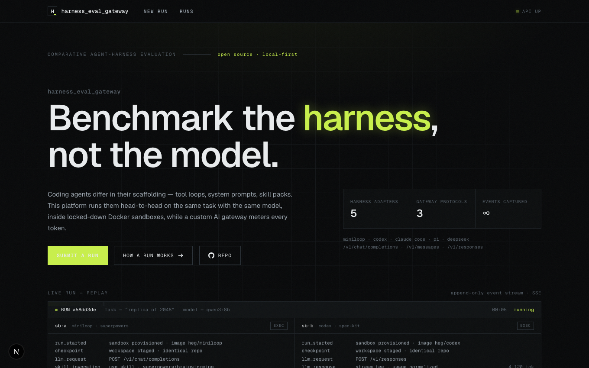
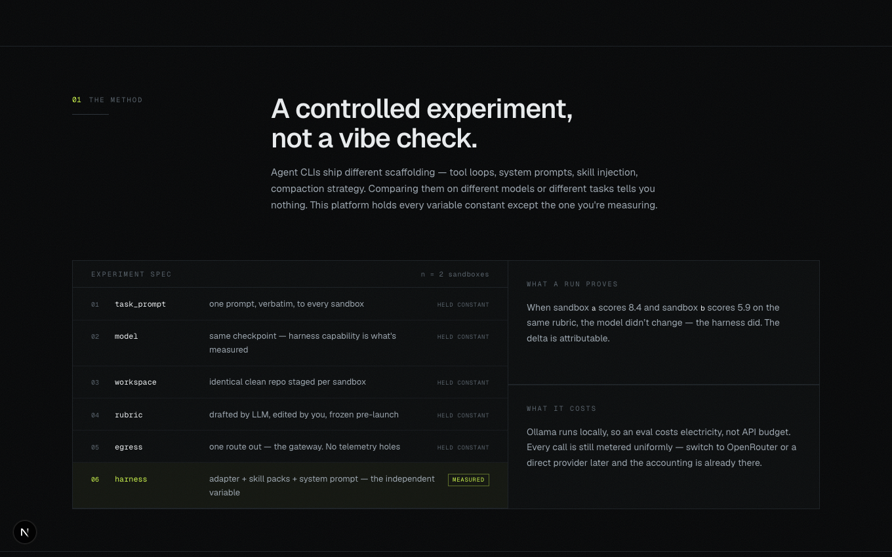
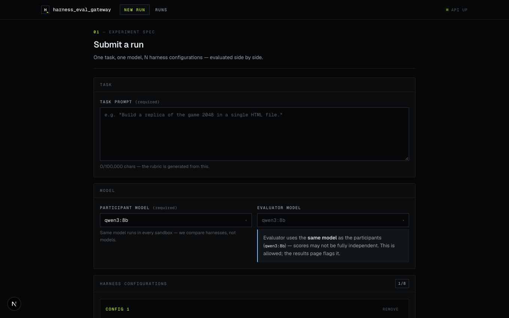
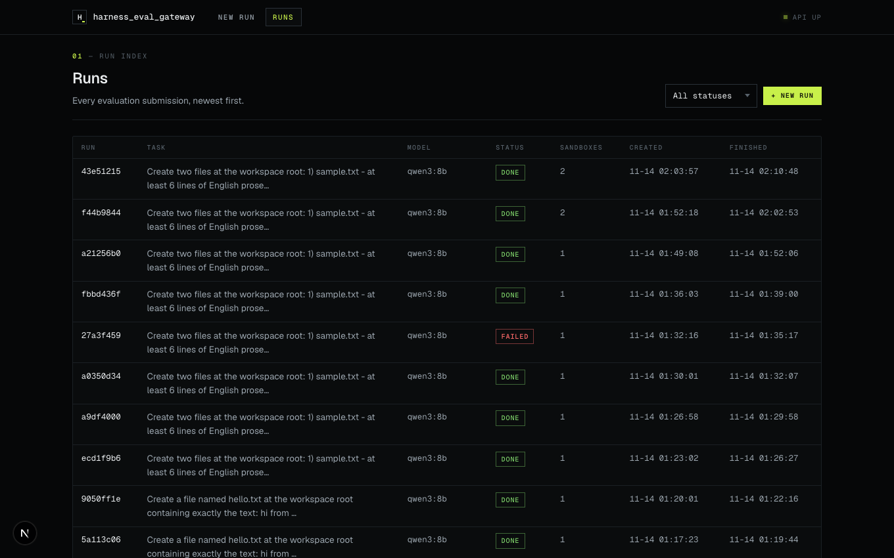
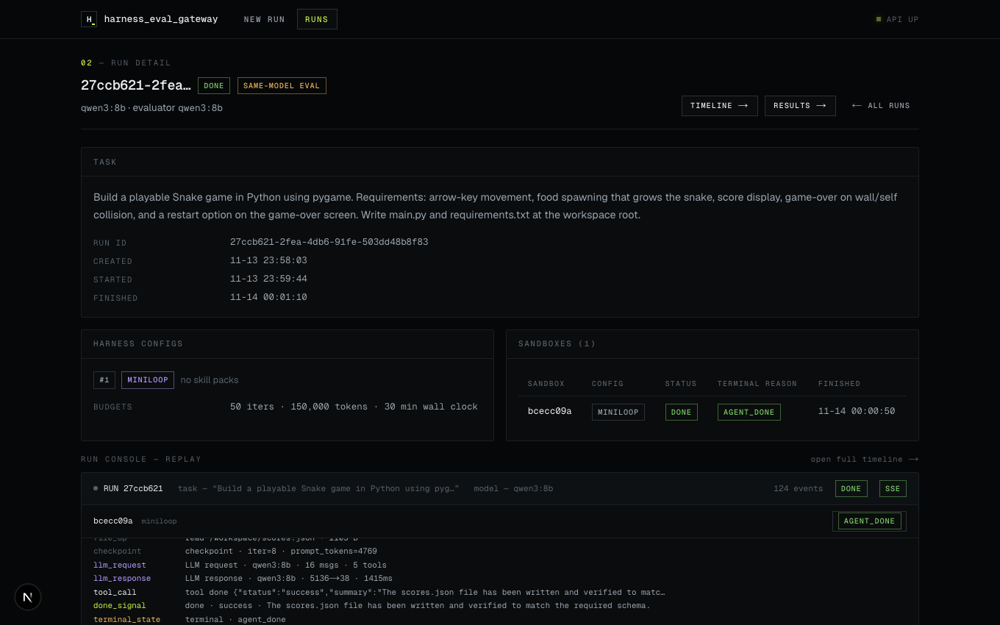
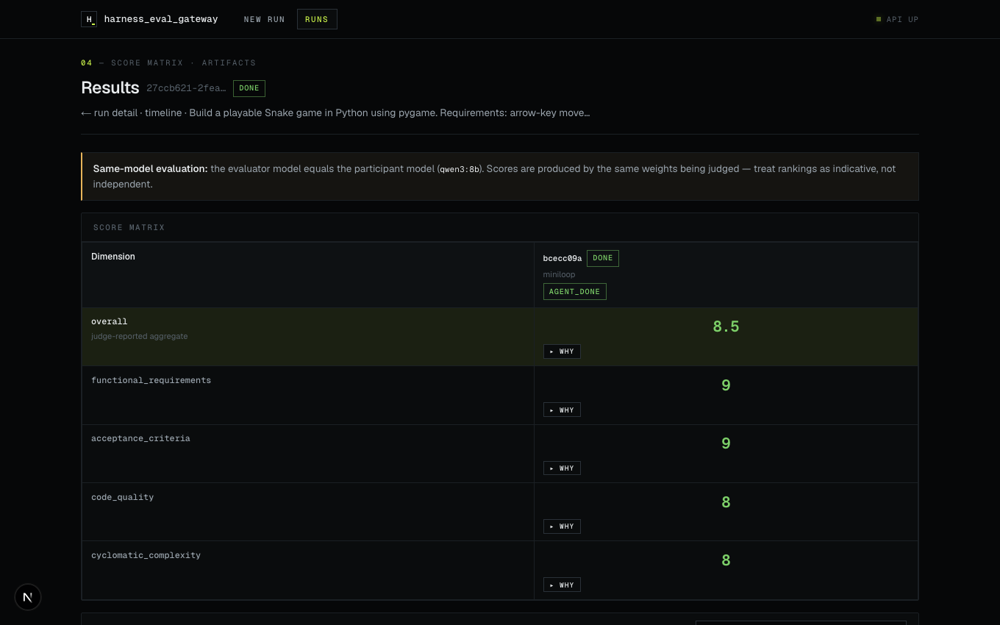
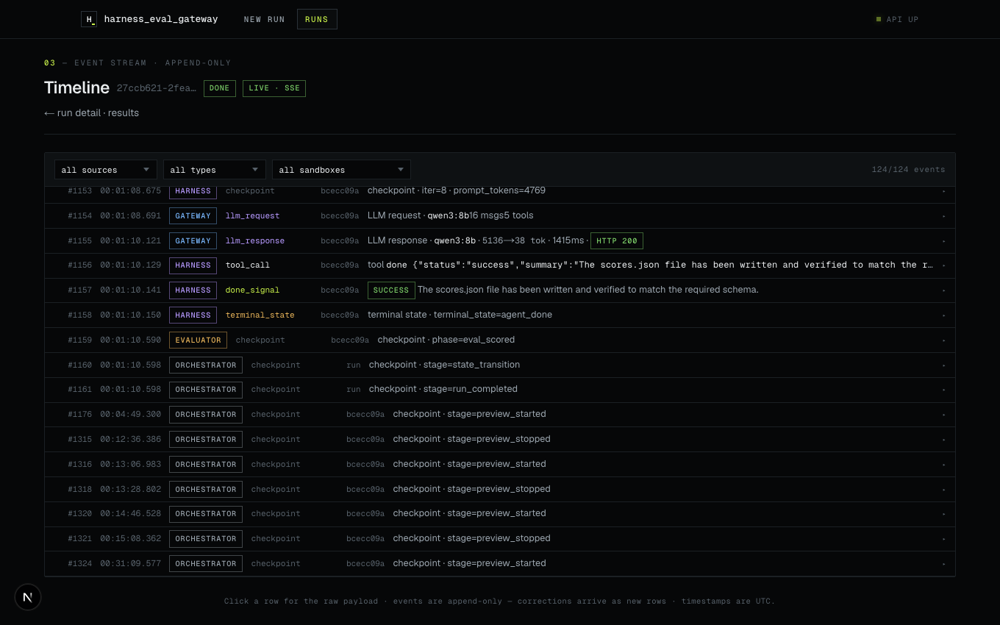
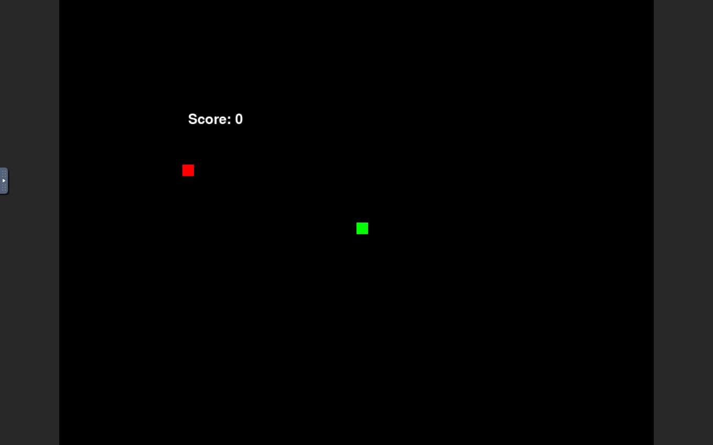

# harness_eval_gateway

A platform for comparatively evaluating **AI coding-agent harnesses** on coding
tasks, with a custom AI gateway as the observability layer. See
[AGENTS.md](./AGENTS.md) for the product vision/architecture and
[FEATURE_MAP.md](./FEATURE_MAP.md) for the feature index (what's built, where it
lives, how to verify).

**MVP:** 1 model (local Ollama) × 2 miniloop harness configs → 2 concurrent
Docker sandboxes, rubric-scored by a sandboxed evaluator.

## Screenshots

| Landing — hero | Landing — the method |
|---|---|
|  |  |

| Submit a run | Runs list | Run detail |
|---|---|---|
|  |  |  |

| Results — score matrix | Timeline — live event stream |
|---|---|
|  |  |

**Live artifact previews** — produced artifacts run in throwaway, locked-down
containers straight from the results page: static sites served on localhost,
pygame/desktop apps streamed interactively via noVNC:



## Layout

```
api/           FastAPI control-plane (health endpoints in F0)
db/            SQLAlchemy models + Alembic migrations (db/migrations/)
gateway/       LLM proxy: providers, metering, budgets      (F3)
orchestrator/  run state machine, rubric gen, lifecycle      (F2)
adapters/      harness adapters — miniloop first             (F5)
sandbox/       image defs, workspace prep, done mechanism    (F4)
evaluator/     rubric scoring agent                          (F7)
scoring/       objective signal collectors (static analysis) (F7)
skillpacks/    vendored default packs                        (F5)
web/           Next.js app                                   (F1/F6/F8)
data/artifacts/  run outputs (gitignored)
tests/         pytest
```

## Quickstart

Prereqs: `uv`, `docker` (compose), Node 20+, host **Ollama**
(`brew install ollama && ollama serve`, then `ollama pull qwen2.5-coder:3b`).

```bash
# 1. Infra: Postgres (+ api container, optional)
docker compose up -d            # postgres on :5433, api on :8001

# 2. Backend (local dev, hot reload)
uv sync
uv run alembic upgrade head     # create schema
uv run uvicorn api.main:app --reload --port 8001   # http://localhost:8001/health

# 3. Frontend
cd web && npm install && npm run dev   # http://localhost:3000
```

Checks: `curl localhost:8001/health` → `{"status":"ok"}`,
`curl localhost:8001/health/db` → `{"ok":true}`,
`uv run pytest` → smoke tests green.

## Database migrations

```bash
uv run alembic upgrade head                    # apply
uv run alembic revision --autogenerate -m "..."  # new migration (needs live DB)
uv run alembic upgrade head --sql              # offline SQL preview
```

`DATABASE_URL` comes from env / `.env` (see `.env.example`; copy to `.env`).

## Conventions

- Python 3.12+, type hints, pydantic at boundaries, asyncio for I/O.
- `events` table is **append-only** — never update/delete rows.
- Update `FEATURE_MAP.md` when a feature's paths/tests/UI change (definition of
  done). Dev-environment commands also live in `AGENTS.md` → Working conventions.
