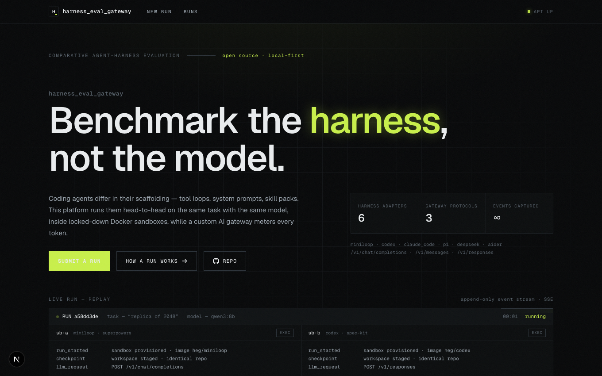
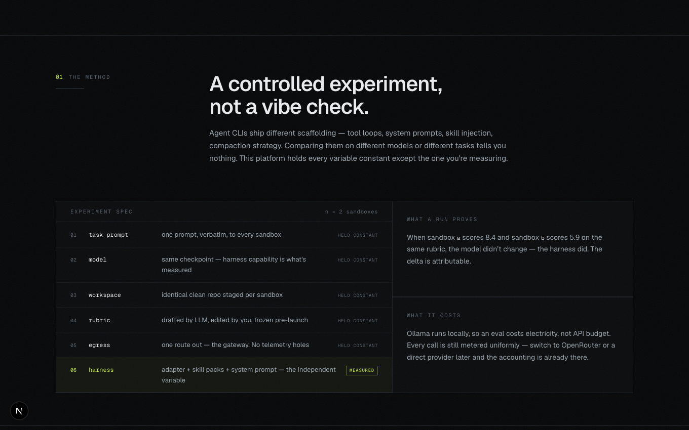
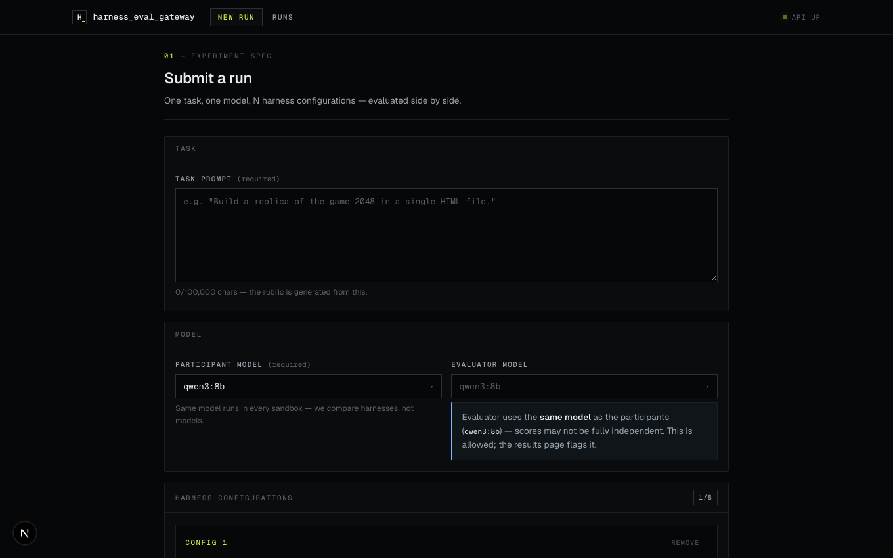
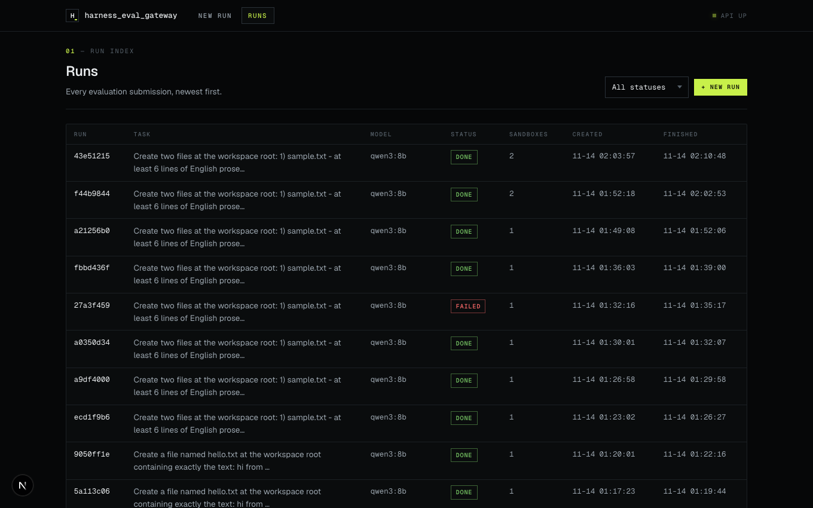
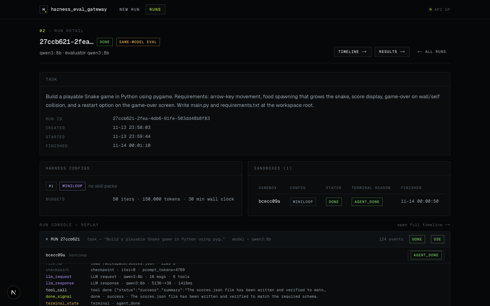
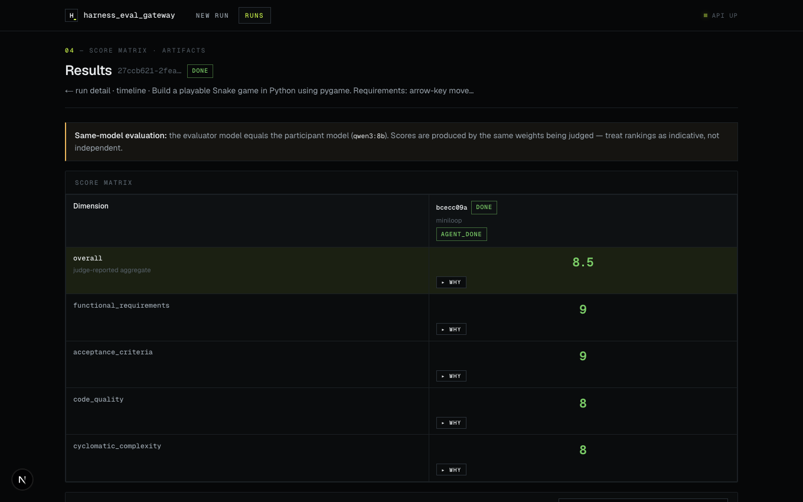
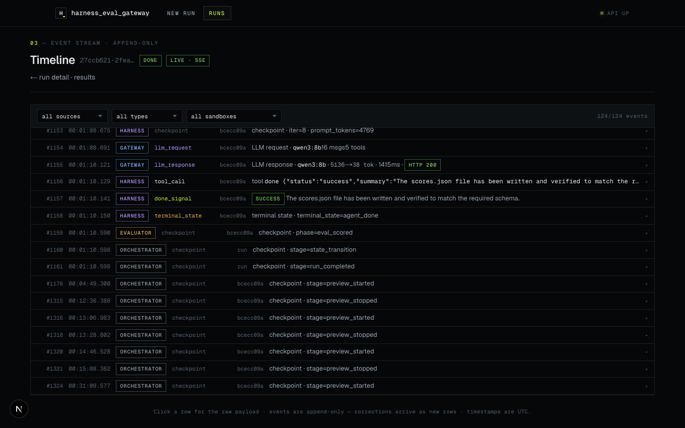
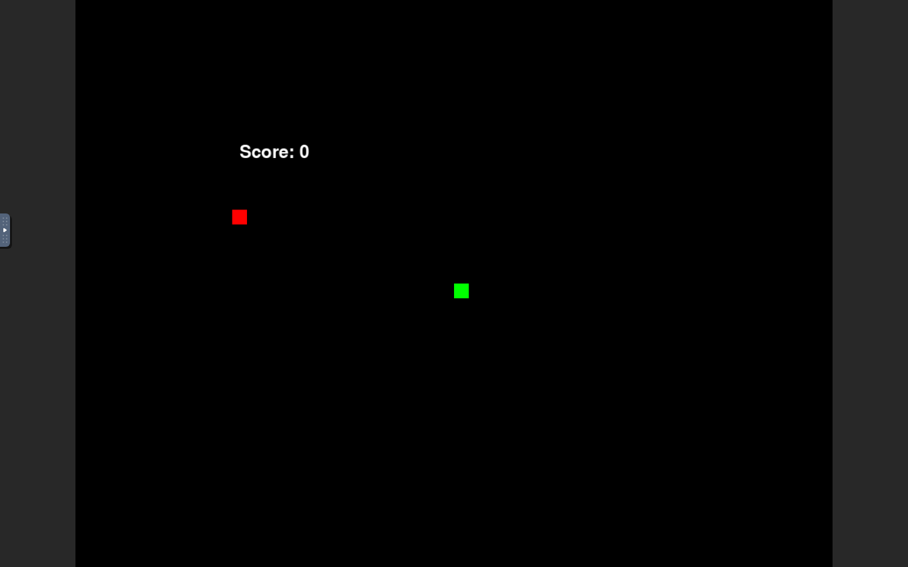

# harness_eval_gateway

A platform for comparatively evaluating **AI coding-agent harnesses** on coding
tasks, with a custom AI gateway as the observability layer. See
[AGENTS.md](./AGENTS.md) for the product vision/architecture and
[FEATURE_MAP.md](./FEATURE_MAP.md) for the feature index (what's built, where it
lives, how to verify).

**MVP:** 1 model (local Ollama) × 2 miniloop harness configs → 2 concurrent
Docker sandboxes, rubric-scored by a sandboxed evaluator.

## Screenshots

| Landing — hero | Landing — the method |
|---|---|
|  |  |

| Submit a run | Runs list | Run detail |
|---|---|---|
|  |  |  |

| Results — score matrix | Timeline — live event stream |
|---|---|
|  |  |

**Live artifact previews** — produced artifacts run in throwaway, locked-down
containers straight from the results page: static sites served on localhost,
GUI apps (pygame/pyglet/arcade/tkinter) streamed interactively via noVNC,
python web apps (flask/django/…) executed and served on localhost:



## Layout

```
api/           FastAPI control-plane (health endpoints in F0)
db/            SQLAlchemy models + Alembic migrations (db/migrations/)
gateway/       LLM proxy: providers, metering, budgets      (F3)
orchestrator/  run state machine, rubric gen, lifecycle      (F2)
adapters/      harness adapters — miniloop + shipped CLIs    (F5/F10)
sandbox/       image defs, workspace prep, done mechanism    (F4)
evaluator/     rubric scoring agent                          (F7)
scoring/       objective signal collectors (static + exec/coverage) (F7)
skillpacks/    vendored default packs                        (F5)
task_presets/  vendored task presets                         (F24)
rubric_templates/  vendored rubric template JSON             (F26)
benchmark_suites/  vendored suite.yaml task lists + checks   (F25)
web/           Next.js app (incl. /dashboard, /compare, /leaderboard + /share)  (F1/F6/F8/F27/F28/F29)
data/artifacts/  run outputs (gitignored)
tests/         pytest
```

## Quickstart

Prereqs: Docker with Compose, Node 22.18+ (also used by the web tests),
and [Ollama](https://ollama.com/download) on the host. The API and gateway
connect to `host.docker.internal:11434`. With Docker Desktop, start Ollama
normally. On native Linux Docker Engine, start Ollama on the Docker bridge
address instead of loopback; Compose already maps `host.docker.internal`
to the host gateway:

```bash
bridge_ip=$(docker network inspect bridge --format '{{(index .IPAM.Config 0).Gateway}}')
export OLLAMA_HOST="${bridge_ip}:11434"
ollama serve
```

If Ollama is already running as a service, set that service's `OLLAMA_HOST`
and restart it instead. Binding to the bridge address avoids listening on
all host interfaces. In a second terminal, set the same `OLLAMA_HOST` on
native Linux so the Ollama CLI can reach the server, then download the model:

```bash
ollama pull qwen2.5-coder:3b
```

From the repository root, start Postgres, apply migrations, build the images
used by the default run, and start the API and gateway:

```bash
docker compose up -d --wait postgres
docker compose run --rm --build api alembic upgrade head
docker build -f sandbox/images/miniloop.Dockerfile -t heg-sandbox:latest .
docker build -f sandbox/images/exec.Dockerfile -t heg-exec:latest .
docker compose up -d --wait       # API :8001, gateway :8081, Postgres :5433
```

For other sandboxed adapters, build the image using the command at the top of
its Dockerfile in [`sandbox/images/`](sandbox/images).

```bash
curl -fsS http://localhost:8001/health       # {"status":"ok"}
curl -fsS http://localhost:8001/health/db    # {"ok":true}
curl -fsS --retry 10 --retry-all-errors --retry-delay 1 http://localhost:8001/api/models
cd web && npm ci && npm run dev              # http://localhost:3000
```

The model catalog should include `qwen2.5-coder:3b`; the retry gives the
gateway time to start on the first boot.

Use the Compose API for end-to-end runs. For API-only development with hot
reload, run `docker compose stop api` to free port 8001. Keep the Compose
gateway running on port 8081 so endpoints such as `/api/models` still work.
With [`uv`](https://docs.astral.sh/uv/)
installed, run `uv sync` and `uv run uvicorn api.main:app --reload --port 8001`
from the repo root. If Ollama is bound to the Docker bridge, set
`OLLAMA_BASE_URL="http://$OLLAMA_HOST"` in the API environment as well.
Run backend tests with `uv run pytest`.

## Database migrations

```bash
uv run alembic upgrade head                    # apply
uv run alembic revision --autogenerate -m "..."  # new migration (needs live DB)
uv run alembic upgrade head --sql              # offline SQL preview
```

`DATABASE_URL` comes from env / `.env` (see `.env.example`; copy to `.env`).

## Conventions

- Python 3.12+, type hints, pydantic at boundaries, asyncio for I/O.
- `events` table is **append-only** — never update/delete rows.
- Update `FEATURE_MAP.md` when a feature's paths/tests/UI change (definition of
  done). Dev-environment commands also live in `AGENTS.md` → Working conventions.
