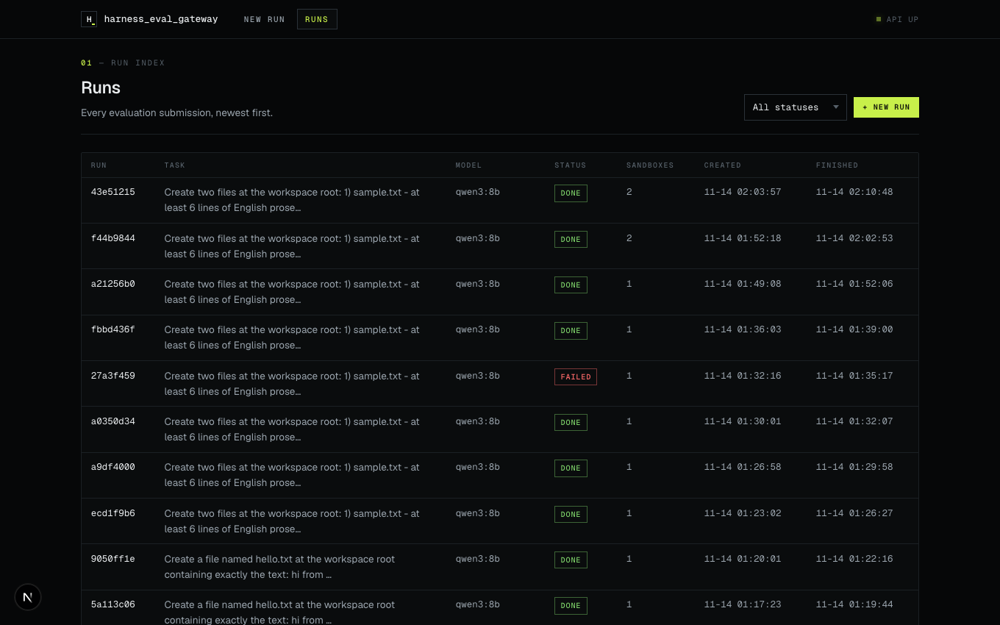
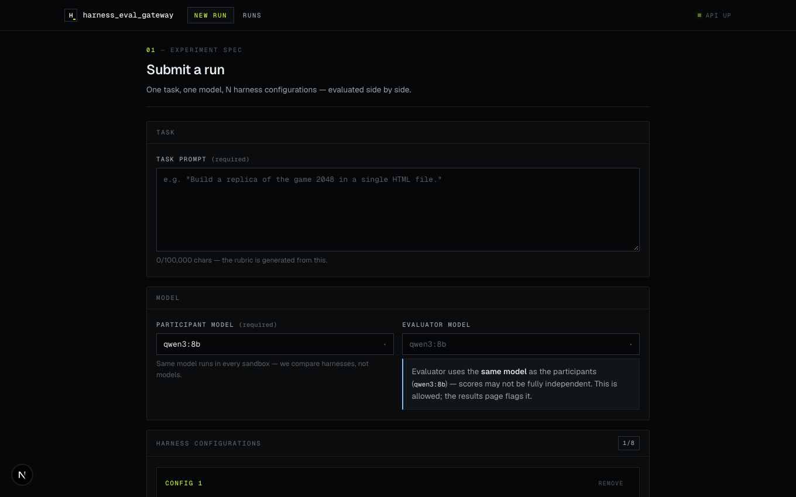
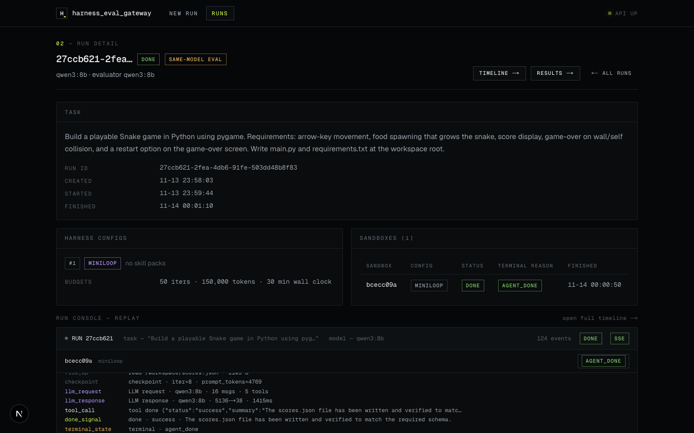
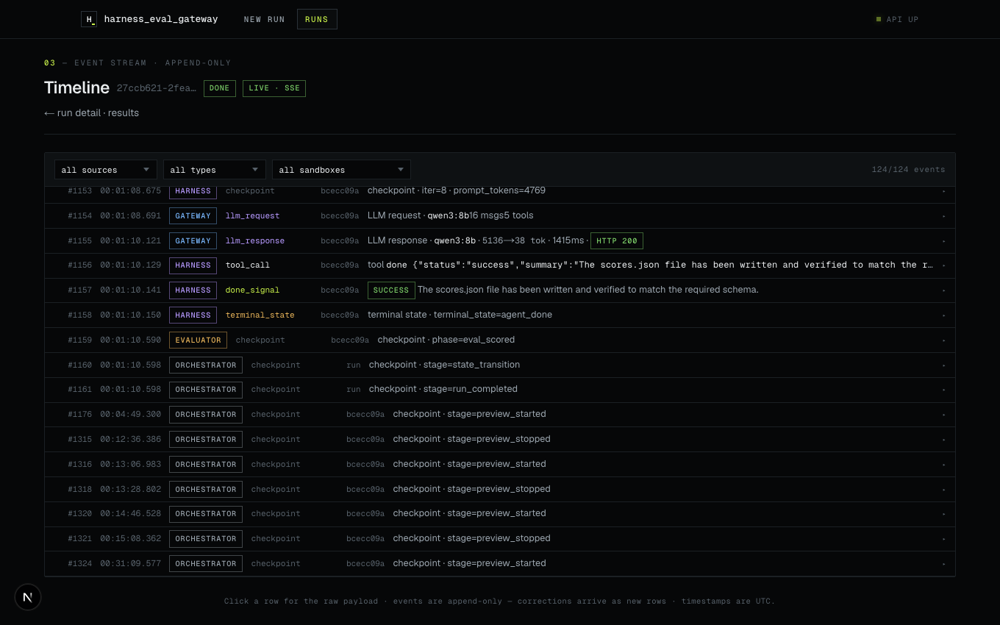
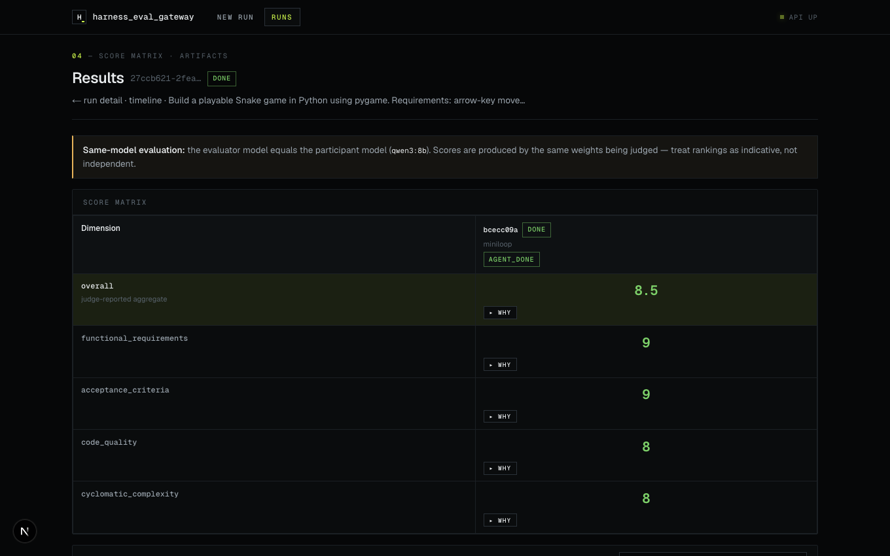

# Phase 2 — Orchestrator, Evaluator, and UI complete the MVP loop

The full run lifecycle works end-to-end on real tasks:

submit → rubric draft → HITL approval → 2 parallel egress-locked sandboxes
→ live SSE timeline → per-artifact LLM evaluation → scored results matrix.

Phase 2 also landed 18 pipeline-driven hardening fixes: eval credential
TTL/budget handling, per-evaluator isolation, adversarial-workspace defenses
(symlink write-through, FIFO deadlock, zip-jail escape, special-file copy),
orphaned-container cleanup, state-machine routing, and artifact IDs in the
results API.

## Surfaces

### Run list

All submitted runs with status and model. Multiple real runs completed:
a Wordle game (both configs scored) and a 2048 replica (first live
`stuck_loop` capture).

### Submit form

Task prompt, model, per-sandbox harness configs (adapter, skill packs,
system-prompt extras), evaluator model, and budgets.

### Run detail

Run status, harness configs, sandbox table with per-sandbox status and
terminal reason — this run shows a miniloop sandbox reaching `agent_done`
— plus the approved/frozen rubric.

### Live timeline

Append-only events with per-source/per-type/per-sandbox filters:
LLM requests and responses with token counts and latency, tool calls,
shell commands, file ops, checkpoints, skill invocations, done signals,
evaluator events, preview lifecycle checkpoints, and the error row when
a judge exits without scores.

### Results matrix

Score matrix (sandbox × rubric dimension) with per-cell rationale
("why"), same-model-evaluation warning banner, and per-sandbox artifact
downloads (workspace, transcript, meta).

