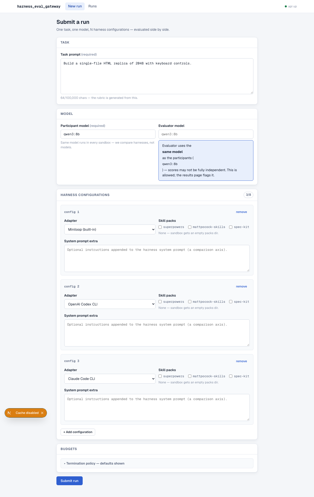
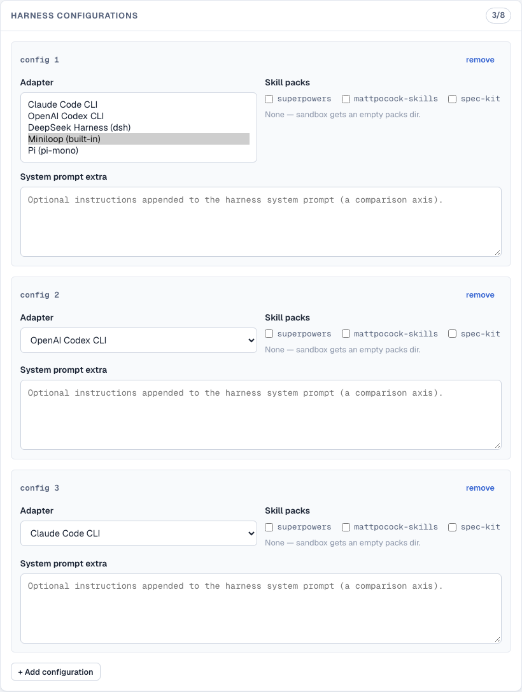
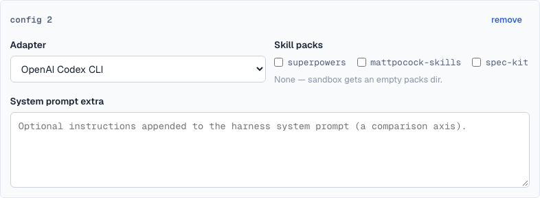

# PR: Phase 2.5 — multi-harness adapters (Codex, Claude Code, Pi, DeepSeek)

Runs can now compare **real coding-agent harnesses**, not just miniloop
configurations. Submitting a run with `harness_configs[].adapter` set to
`codex`, `claude_code`, `pi`, or `deepseek` spawns one isolated Docker
sandbox per config running that CLI against the run's model — all model
traffic still flows through the AI gateway, all activity still lands as
normalized events on the timeline, and `HEG_RESULT` terminal markers drive
the existing lifecycle/monitor machinery unchanged.

Design doc: [`docs/p25-harness-adapters.md`](./p25-harness-adapters.md)

## Feature overview

- Five registered adapters: `miniloop` (existing), `codex`
  (`@openai/codex`), `claude_code` (`@anthropic-ai/claude-code`), `pi`
  (`@mariozechner/pi-coding-agent`), `deepseek` (`@deepseek-ai/dsh`).
- A stdlib-only **shim** (`adapters/common/`) runs inside each CLI image:
  writes the harness's native config pointing at the gateway, launches the
  CLI in machine-readable JSONL mode, translates native records →
  normalized `EventType` events, posts them to `/internal/events`, emits
  `terminal_state` and prints `HEG_RESULT {…}`.
- Per-adapter npm-pinned Docker images under `sandbox/images/`; the
  orchestrator resolves each config's image via
  `image_spec()["image"]` (miniloop keeps the `SANDBOX_IMAGE` fallback, so
  evaluator/test overrides are untouched).
- `GET /api/harnesses` serves adapter manifests (display name, LLM
  protocol, CLI, image) which the submit form's harness dropdown consumes
  live, with a static fallback list when the API is unreachable.

## Architecture

```
submit form ──GET /api/harnesses──▶ adapter manifests (registry)
     │ POST /api/runs (adapter per harness_config)
     ▼
provision.spawn_one ──▶ image = config.image > image_spec()["image"] > SANDBOX_IMAGE
     ▼
sandbox: python3 -m adapters.<name>            (the shim)
  ├─ write native config (config.toml / .claude.json / models.json /
  │  cordis.patch.yml) → gateway URL + per-sandbox cred
  ├─ spawn CLI in JSONL mode, cwd=/workspace
  ├─ translate records → normalized events → stdout JSONL + /internal/events
  └─ exit → terminal_state + HEG_RESULT marker
     │
     ▼  LLM traffic (only egress: http://gateway:8080)
gateway: /v1/chat/completions · /v1/messages(+count_tokens) · /v1/responses
         · /v1/models  ──▶ Ollama upstream (all three served natively)
```

**Adapter registry** (`orchestrator/adapters.py`): each adapter module
declares a `MANIFEST` (name, display_name, description, llm_protocol, cli,
cli_version, install, image, requires). `harnesses()` returns the sorted
manifest list for `GET /api/harnesses`; `adapter_image()` resolves sandbox
images with the miniloop fallback.

**Shared shim** (`adapters/common/runner.py`): `ShimConfig.from_env()`
reads the common env contract (`GATEWAY_BASE_URL`, `GATEWAY_CRED`,
`MODEL_NAME`, `TASK_PROMPT`, `WORKSPACE`, `SKILLPACKS_ROOT`,
`EVENTS_INGEST_URL`, `SYSTEM_PROMPT_EXTRA`); `run_shim()` handles
setup → spawn → translate → terminal marker. Exit convention: 0 for
non-error terminal states, 2 on error — same as miniloop's adapter.

**Gateway protocol fan-out**: Ollama natively serves all three upstream
protocols, so the new endpoints are pure cred-gated, metered pass-throughs
— no protocol translation:

- `POST /v1/messages` (+ `/v1/messages/count_tokens` unmetered preflight)
  for Anthropic-SDK CLIs (Claude Code, dsh).
- `POST /v1/responses` for Codex CLI (wire_api `chat` was removed upstream).
- `GET /v1/models` for CLI probes.
- `stream: true` bodies get an SSE tee — chunks pass through verbatim and
  usage is scraped from terminal SSE events (`usage_from_sse`:
  `message_start`/`message_delta` for Anthropic, `response.completed` for
  Responses, terminal `chat.completion.chunk` for OpenAI).
- `/v1/chat/completions` now honors `stream: true` the same way (pi's
  provider hard-codes it); callers without `stream` keep the buffered
  non-streamed path.
- Auth accepts `x-api-key` as well as `Authorization: Bearer` (Anthropic
  SDK convention — dsh sends the cred as `x-api-key`).
- Usage normalization keeps canonical `prompt_tokens`/`completion_tokens`/
  `total_tokens` so analytics + budgets work unchanged across protocols.

## Files changed (55 files, +4899/−79 vs `feat/phase-2`)

| Area | Files |
|---|---|
| Shim framework | `adapters/common/` (`runner.py`, `contract.py`) |
| Adapters | `adapters/{codex,claude_code,pi,deepseek}/` (`adapter.py`, `config.py`, `translate.py`, `__main__.py`); `adapters/miniloop/adapter.py` (+MANIFEST) |
| Registry/provisioning | `orchestrator/adapters.py`, `orchestrator/provision.py` (per-adapter image), `api/routers/harnesses.py`, `api/schemas.py` (adapter validation) |
| Gateway | `gateway/main.py` (protocol routes, streaming tee, x-api-key), `gateway/metering.py` (usage normalization per protocol) |
| Images | `sandbox/images/{codex,claude_code,pi,deepseek}.Dockerfile` |
| UI | `web/lib/api.ts` (`listHarnesses`, `HarnessManifest`), `web/app/submit/page.tsx` (manifest-driven dropdown) |
| Tests | `tests/unit/adapters/` (contract + per-adapter + common runner), `tests/unit/api/test_harnesses.py`, multi-adapter submit test, gateway protocol tests, `tests/integration/test_adapter_images.py` (docker-marked) |
| Docs | `docs/p25-harness-adapters.md`, `FEATURE_MAP.md` (F10), `AGENTS.md`, this file |

## Verification

- `uv run ruff check .` — clean.
- `uv run pytest -m "not docker"` — **364 passed** (gateway 46, adapters
  170+, api incl. `/api/harnesses` + multi-adapter submit).
- `uv run pytest -m docker tests/integration/test_adapter_images.py` —
  **8 passed** (pinned CLI `--version` runs in each image; shim always
  emits `HEG_RESULT`, even with no reachable upstream).
- `cd web && npm run lint && npm run build` — green.
- **Live E2E on an isolated gateway+sandbox topology** (real Ollama
  `qwen3:8b`, egress locked to gateway): all four CLIs completed
  "create hi.txt with 'hello world'" — Codex via `/v1/responses`, Claude
  Code via `/v1/messages`, Pi via streamed `/v1/chat/completions`, dsh via
  `/v1/messages` — each produced the file and exited
  `HEG_RESULT harness_complete` with normalized events flowing.

Bugs found and fixed by the live runs: forced `stream:false` broke pi's
SSE parser; dsh sends `x-api-key`; `cordis.patch.yml` is a loader
patch-entry array (not a providers map); dsh's 256k `maxTokens` default
tripped the budget gate; `done` is a sh/bash keyword (prompt footer now
instructs `/usr/local/bin/done`); dsh needs `node:24-slim`.

## Known gaps / follow-ups

- npm ≥11 blocks postinstall scripts → dsh's
  `@deepseek-ai/dsh-subprocess-local` spawn-helper and node-pty/koffi
  native builds are skipped in its image; the CLI runs fine (verified
  live). **On the roadmap**: allow-scripts for that package set if a
  sandboxed dsh workflow ever needs them.
- CLI harnesses can't honor `max_iters`; wall-clock/token budgets still
  cap them (noted in manifests/UI copy).
- `skill_packs` for CLI harnesses = read-only mount + prompt hint (no
  native skill invocation); `skill_invocation` stays miniloop-only.
- Compose e2e of the full run pipeline with multiple harnesses wasn't
  exercised (dev port conflicts); sandbox-level e2e coverage is the
  docker-marked suite + live runs above.

## Resolved decisions

- **Pinned npm versions**: `@openai/codex@0.169.0`,
  `@anthropic-ai/claude-code@2.1.325`,
  `@mariozechner/pi-coding-agent@0.73.1`, `@deepseek-ai/dsh@0.2.2-rc.1`
  (dsh only ships rc tags). Reproducible images beat floating latest.
- **dsh `maxTokens` clamp**: 16384 in the overlay (`DSH_MAX_TOKENS` env
  override) — dsh's 256k default would instantly 429 every request at the
  run budget gate.
- **dsh postinstall scripts left blocked**: documented follow-up rather
  than widening npm script permissions in the image build.
- **Manifests in UI**: dropdown uses `display_name` + `name` only —
  protocol/version/install metadata stays in `GET /api/harnesses` +
  manifests for tooling, not surfaced in the form.
- **DeepSeek image base**: `node:24-slim` (dsh engines `>=24.9`); other
  CLI images stay on `node:22-slim`.
- **Codex `disable_response_storage` removed** from generated config —
  current codex no longer accepts it.

## Screenshots

Harness selection on the submit form (manifest-driven dropdowns, three
configs comparing different adapters):




