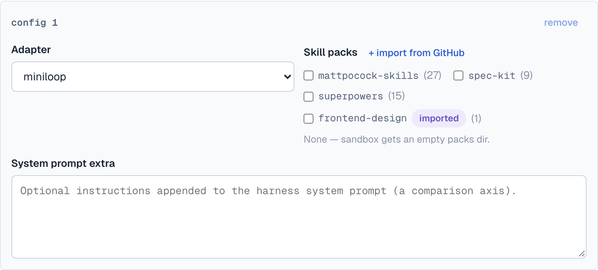
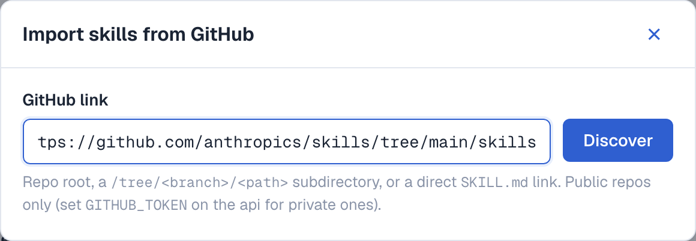
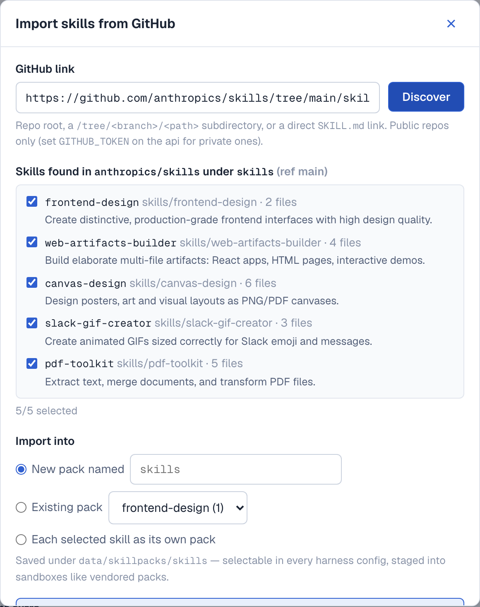
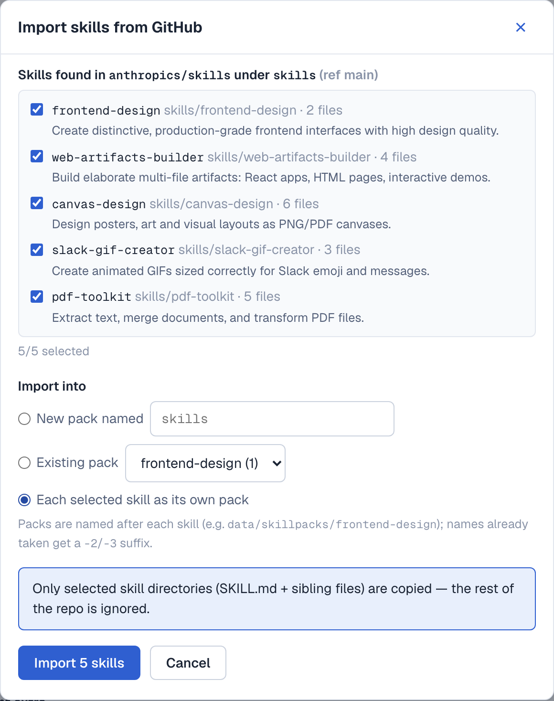
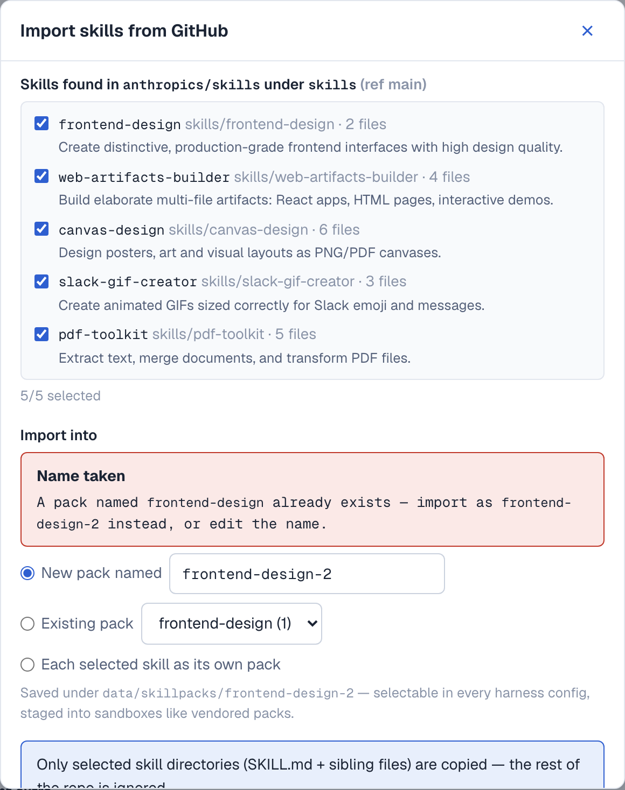
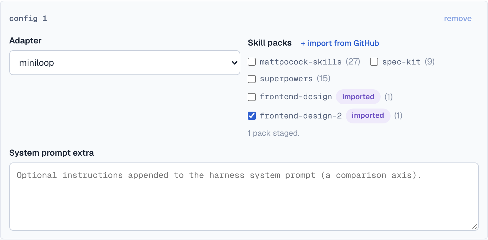

# F11 — Import skill packs from GitHub

Users can paste a GitHub link into the submit form, discover the `SKILL.md`
skills inside, select a subset, and import them — as one named pack, merged
into an existing pack, or split one-pack-per-skill. Imported packs are
persisted under `data/skillpacks/`, listed alongside vendored packs, and
staged into sandboxes at `/opt/skillpacks` like any other pack.

Feature ID: **F11** (see `FEATURE_MAP.md`). Two commits on this branch:
`24c1565` (core feature) + `703bf14` (collision/mode follow-up).



## Flow

1. **Paste a link.** Accepted shapes: repo root (`github.com/owner/repo`,
   scheme-less, `.git`, query/fragment ok), subdirectory
   (`/tree/<branch>/<path>` — branch names containing slashes resolved by
   longest-first probing), a direct `SKILL.md` (`/blob/<branch>/<path>/SKILL.md`
   or `raw.githubusercontent.com`), optionally pinned to a tag/SHA.
2. **Discover.** The backend fetches the repo via **codeload tarball**
   (one request; Contents API fallback), scans `SKILL.md` files recursively,
   parses frontmatter `name`/`description` (dir-name / first-body-line
   fallbacks), and returns candidates with `file_count`, `has_frontmatter`,
   resolved `ref`, and `commit_sha` (used to pin the import to the tree that
   was discovered).
3. **Select + import.** Checkbox list of candidates, then one of three
   `mode`s (below). Only selected skill directories — `SKILL.md` plus its
   sibling files — are copied.

| 02 — paste link | 03 — candidates |
|---|---|
|  |  |

## Three import modes

- **`pack`** — all selected skills land in ONE new pack named `pack_name`.
  A taken name never silently merges — it goes through the
  confirm-and-rename flow (next section).
- **`merge`** — skills are appended into an existing *imported* pack
  (`pack_name` selects it; a fresh name creates it). Vendored targets are
  rejected — appending to vendored packs is never allowed.
- **`split`** — every selected skill becomes its own pack named after the
  skill dir (`skills/frontend-design` → `frontend-design`). Collisions are
  auto-renamed `x` → `x-2` and reported in the response `issues` (the
  simpler of the two proposed shapes — no per-skill rename round-trips).



## Confirm-and-rename collision flow

When `mode=pack` targets a name that already exists — **vendored or
imported** — the API returns `409` with structured detail instead of a bare
error:

```json
{"detail": {"kind": "name_conflict",
            "name": "frontend-design",
            "source": "imported",
            "suggested_name": "frontend-design-2"}}
```

`suggest_pack_name()` finds the first free `name-2`, `name-3`, … (a base
already ending in `-N` continues at `N+1`: `x-9` → `x-10`; stems truncated
to stay ≤64 chars). The dialog shows a "Name taken" notice, prefills the
suggestion, and lets the user edit or confirm — resubmits carry the new
`pack_name`; a still-colliding retry returns the next suggestion.

| 05 — collision notice | 06 — renamed pack auto-selected |
|---|---|
|  |  |

## Storage & resolution

- Imported packs live under **`data/skillpacks/<pack>/`** — the gitignored,
  bind-mounted data tree — deliberately *not* `skillpacks/` (vendored packs
  are committed and baked into the api image via `COPY . .`). The root is
  derived from `ARTIFACT_ROOT.parent` (`./data/skillpacks` dev,
  `/data/skillpacks` in compose) and overridable via
  `IMPORTED_SKILLPACKS_DIR`. `.dockerignore` excludes it from the image.
- Each pack gets a `PACK.json` manifest: `source: "github-import"`,
  upstream URL/repo/ref/`commit_sha`, `imported_at`, per-import skill list.
- Imported + vendored share **one name namespace** everywhere:
  `GET /api/skillpacks`, `POST /api/runs` `skill_packs` validation, and
  provisioning (`known_skillpacks(*roots)`, `stage_skillpacks(extra_roots=)` —
  vendored searched first) so a `skill_packs` value is unambiguous.
- Writes are all-or-nothing (rollback on failure); pack/skill names and
  extracted paths are sanitized (`[A-Za-z0-9][A-Za-z0-9_-]{0,63}`, `..`/
  absolute/NUL rejected, archive members jail-checked, download/tar caps).

## API surface

| Endpoint | Purpose |
|---|---|
| `GET /api/skillpacks` | All selectable packs — vendored + imported (submit form + run-validation source of truth). |
| `POST /api/skillpacks/discover` | GitHub URL → repo scan → candidate skills + resolved ref/sha. |
| `POST /api/skillpacks/import` | Persist selection per `mode` → `{"packs": [...]}` (201). Collision → structured 409 above. |
| `DELETE /api/skillpacks/{name}` | Remove an imported pack (204); vendored → 409. |

GitHub errors map to clear statuses: invalid URL → 422, repo not found →
404, too-large payload → 413, rate-limit/network → 502. The HTTP `Fetcher`
is an injectable FastAPI dependency — tests swap in a fake, no network.

## Frontend

`web/app/submit/ImportSkillPackDialog.tsx` (URL step → candidate list →
mode radios → collision rename notice), dynamic pack loading on the submit
page (vendored constant is now only the fallback), auto-selects every pack
produced by an import into the config that opened the dialog,
`web/lib/api.ts` clients + `ApiError.rawDetail`/`nameConflictOf()` for the
structured 409, modal styles in `globals.css`.

## Files changed

New: `skillpack_import/{__init__,github,store}.py`,
`api/routers/skillpacks.py`, `tests/unit/api/{conftest,
test_skillpack_import,test_skillpacks}.py`,
`web/app/submit/ImportSkillPackDialog.tsx`

Modified: `api/{config,main,schemas}.py`, `api/routers/runs.py`,
`orchestrator/provision.py`, `web/{lib/api.ts,app/submit/page.tsx,
app/globals.css}`, `.dockerignore`, `docker-compose.yml`,
`skillpacks/README.md`, `AGENTS.md`, `FEATURE_MAP.md`

## Verification

- `uv run ruff check .` — clean
- `uv run pytest -m "not docker"` — **340 passed** (100 skillpack-specific:
  URL shapes, ref probing, tarball scan w/ fixtures, frontmatter fallbacks,
  sanitization/size caps, endpoint happy/error paths, dedup, suggestion
  chains, split auto-rename, multi-root staging, run-validation
  discoverability)
- `cd web && npm run lint && npm run build` — clean
- **Live e2e against `anthropics/skills`** (sqlite api): discover
  `tree/main/skills/frontend-design` → import → listed + staged → run
  accepted it → deleted 204; vendored delete → 409. Collision verified
  live: `pack_name=superpowers` → `409 {suggested_name: "superpowers-2",
  source: "vendored"}`; imported collision → `frontend-design-2`; rename
  retry → 201; `split` auto-renamed and reported via `issues`.
- UI screenshots above were captured via
  `docs/screenshots/p25-skillpack-import/capture.mjs` (playwright +
  `page.route` mocks — rerunable, no backend needed).

## Decisions & non-goals

- **Public repos only.** `GITHUB_TOKEN` (env on the api) is sent as a
  Bearer token when set — private repos work best-effort — but no token
  UI/settings flow; that UX is a follow-up.
- **DELETE kept** (imported-only; vendored protected) — confirmed.
- **`mode="pack"` never appends.** Append is explicit (`mode="merge"`) —
  confirmed.
- **Rate limits:** unauthenticated ref/SHA resolution is best-effort under
  the ~60/hr api.github.com cap; tarball fetches + imports still work when
  it degrades. Noted in AGENTS.md known-issues + `skillpacks/README.md`.
- One user, one machine — no ownership/auth model; imported packs are
  local user data.
